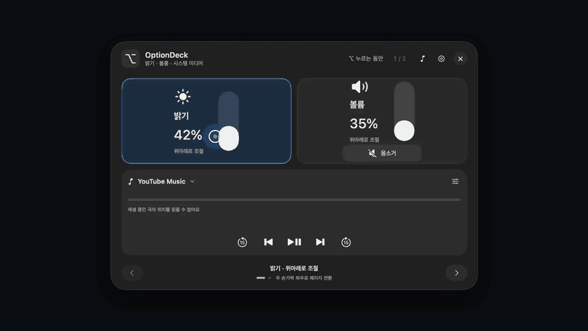

# OptionDeck

**English** · [한국어](README.ko.md)

Hold **Option (⌥)** to turn your Mac trackpad into a control surface. Adjust brightness and volume, control media, launch apps, and arrange your own two-page deck.

## Get started in 30 seconds

<picture>
  <source media="(prefers-reduced-motion: reduce)" srcset="docs/assets/quickstart-poster.png">
  
</picture>

[Watch or download the 30-second MP4](docs/assets/quickstart.mp4) · [Static preview](docs/assets/quickstart-poster.png)

A caption-free, 30-second capture of the actual native SwiftUI interface, composed with [OpenDesign](https://open-design.ai/solutions/video/) MCP and HyperFrames. The UI is rendered offscreen with scripted preview inputs; device values and personal settings are not changed. The static preview is used when reduced motion is preferred. The app's current interface is in Korean; this README includes translations for its main controls.

## Build and run

Requires **macOS 14+**, a **Swift 6** toolchain, and **Rust 1.99+** for building. The current packaged build is for Apple silicon. Install [Xcode Command Line Tools](https://developer.apple.com/xcode/resources/) and [Rust](https://rust-lang.org/tools/install/) first.

```sh
git clone https://github.com/a1paka12/OptionDeck.git
cd OptionDeck
zsh scripts/build.sh
open dist/OptionDeck.app
```

The build script compiles the Rust engine and links it into the native Swift app. Cargo downloads the locked dependencies on the first build. People receiving a built app do not need Swift or Rust installed.

1. Open **System Settings → Privacy & Security → Accessibility** and enable OptionDeck.
2. Hold **⌥** for a moment to open the panel. Release it to return to your work.
3. To explore with a mouse, choose **Open control panel** (`조절 패널 열기`) from the menu-bar ⌥ icon.

Source builds are locally ad-hoc signed and are not notarized. If macOS blocks a build you trust, use its **Open Anyway** option in Privacy & Security. After rebuilding, you may need to remove and re-add the current app in Accessibility.

## Use the trackpad

| Gesture | Action |
| --- | --- |
| Hold ⌥ | Show the deck on the display containing the pointer |
| Move one finger sideways | Find a control without changing its value |
| Move up or down | Adjust the selected slider after acquiring it |
| Tap or press the trackpad | Select an action |
| Swipe horizontally with two fingers | Change pages |
| Release ⌥ | Close the deck and run a queued app, file, website, or menu action |
| Esc | Cancel a queued action |

The system pointer is hidden and held in place during raw trackpad control. Force Touch devices can provide selection, action, and adjustment haptics. Ordinary Option-letter shortcuts continue to reach the active app.

## Make it yours

Open **App & Layout Settings** (`앱 및 배치 설정…`) from the menu-bar icon, or click the panel's gear.

- **Add:** drag a feature from the library into either page. A new tile is created and nearby tiles make room. There are no reserved empty tiles.
- **Move:** drag a tile to a new position. A translucent placeholder previews the result before you release it.
- **Resize:** drag a tile's bottom-right handle. The Rust layout engine reflows nearby tiles and respects minimum slider sizes.
- **Remove:** drag a tile outside the panel preview, or choose **Remove** from its context menu. Remaining tiles reclaim the space.
- **Configure:** click an app, file/folder, website, or automation tile to select its target. Cancelling its picker does not create a tile.
- **Apply:** click **Save & Apply** (`저장 및 적용`). Changes in the editor remain a draft until saved.

Both pages accept brightness, volume, the grouped media widget, mute, the Screenshot tool, apps, files/folders, HTTP(S) websites, and named **macOS Shortcuts** automations. You can repeat apps, remove every tile, and add brightness or volume to either page.

The default first page contains brightness, volume, and a media widget. The second starts with Chrome, VS Code, cmux, Safari, Notion, Terminal, Finder, Voice Memos, and Obsidian; missing apps are not installed automatically.

### App shortcuts

Hover over an app tile on page two to read that running app's real menu commands through the macOS Accessibility API. These are live menu entries, including their current shortcuts and enabled state. Commands not exposed in an app's menu cannot be discovered through this interface.

Select a command and release ⌥ to execute it in the chosen app. OptionDeck revalidates the process, menu path, title, shortcut, and enabled state before pressing the menu item. Esc cancels it. A separate **macOS Shortcuts** tile runs an automation saved in Apple's Shortcuts app by name.

## Music apps and YouTube Music

Choose a default music app in **Settings → Music app** (`음악 앱`), or use the panel's music-note button. When there is no active audio output, Play opens that app. With existing output, playback buttons control the macOS system media target. This preference does not force an already active media session to switch apps, and opening an app does not automatically select a song.

**YouTube Music appears in OptionDeck's automatic detection only after you install YouTube Music as a web app using Google Chrome.** Opening the website in a tab or having a YouTube Music account is not enough.

1. Open [music.youtube.com](https://music.youtube.com/) in **Google Chrome**.
2. Use Chrome's **Install app / Install page as app** option and finish installing YouTube Music.
3. Reopen OptionDeck, then choose it in **Music app** if needed.

See Google's [web-app installation guide](https://support.google.com/chrome/answer/9658361). Another installed music app can be selected manually.

The media widget groups playback, previous/next, skip controls, and a seek bar. The seek bar uses the selected player's actual Accessibility slider. It is enabled only when that player exposes a readable, writable playback position. Otherwise it shows an unavailable state; the widget's system-panel button opens macOS's real media controls. Player and browser support can vary.

## Privacy and compatibility

Settings stay in `~/Library/Application Support/OptionDeck/settings.json`. There is no OptionDeck server, account, analytics service, or paid API requirement. App menu information is read locally. Configured websites and automations perform the actions you assign to them.

The repository excludes local settings, credentials, signing files, build caches, diagnostic captures, personal work notes, and local app/ZIP exports. Documentation media is generated from illustrations and contains no desktop recording or personal data.

Brightness and raw trackpad coordinates rely on optionally loaded private macOS frameworks. Unsupported external displays or audio outputs are disabled. This is an experimental native utility; a successful build does not establish support for every Mac, display, or music player.

## Development

```sh
zsh scripts/test.sh
zsh scripts/build.sh
```

- **Swift / AppKit / SwiftUI:** native UI, Accessibility, system controls, haptics, input handling.
- **Rust:** settings validation, revisioned atomic saves, process/thread locks, stale-response tickets, and adaptive layout.
- **Cargo.lock:** pinned Rust dependencies. The Rust engine is linked statically into the app.

[Motion-graphic source and regeneration instructions](scripts/motion/README.md)
